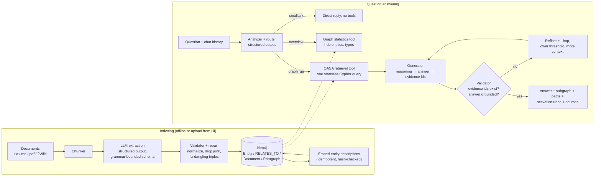
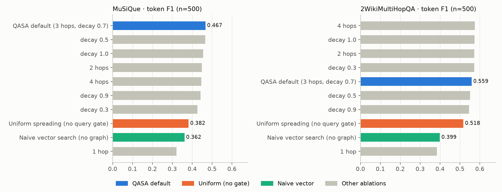
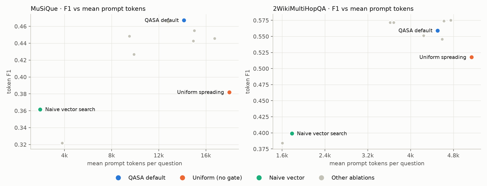

# Synapse: explainable GraphRAG over Neo4j

**Task.** Multi-hop question answering over a document collection, where every answer comes
with the evidence subgraph it was derived from. Example: *"Who is the mother of the director of
film Polish-Russian War?"* needs two hops (film → director → mother) that are spread across
two different documents. Plain vector RAG retrieves the film document but misses the second
hop. Synapse instead builds a knowledge graph from the documents and walks it.

The retrieval core is **QASA (Query-Aware Spreading Activation)** from my research project
(`graph-rag-system`): activation spreads from the question's entities
through the graph, and each step is weighted by how similar the neighbour is to the question.
The whole traversal runs as **one Cypher query inside Neo4j**. This lab wraps that algorithm
into a complete, locally running application with an LLM pipeline around it and a web UI that
replays the reasoning.

Everything runs locally: `qwen3.5:4b` (LLM) + `qwen3-embedding:0.6b` (embeddings) in Ollama,
Neo4j 5 in Docker. One `.env` switch moves the LLM to OpenRouter.

## Architecture



### System components (lab requirement → where it lives)

| Primitive | Implementation |
|---|---|
| **Structured output** | Every LLM call returns a Pydantic model; Ollama compiles the JSON schema into the decoding grammar ([llm.py](synapse_rag/llm.py)). The answer schema puts `reasoning` *before* `answer`, so the model reasons first under constrained decoding ([pipeline.py](synapse_rag/pipeline.py)). |
| **Routing** | The analyzer classifies each message: `graph_qa` → QASA retrieval, `overview` → graph-statistics tool (hub entities, type counts) for global questions, `smalltalk` → no retrieval. |
| **Tool use** | Retrieval is a set of tools over Neo4j: QASA spreading activation, uniform spreading (ablation), naive vector search, graph overview. The router and the mode picker choose between them. |
| **Validation** | *Ingestion:* names normalized, pronouns/generic/numeric entities dropped, self-loops and duplicates removed, triples with missing endpoints repaired ([extraction.py](synapse_rag/extraction.py)). *Answers:* cited evidence ids must exist in the context, and the answer must be grounded in it (token overlap). This catches answers the model knows from pre-training but the graph doesn't contain. |
| **Iterative refinement** | If the answer is insufficient or ungrounded, retrieval runs again with a wider traversal (+1 hop, half the threshold, +15 paths/entities). The UI marks refined answers. |
| **State / memory** | The knowledge graph persists in Neo4j and grows incrementally with idempotent `MERGE`. Chat history goes to the analyzer, which rewrites follow-ups ("А кто тогда его отец?") into standalone questions. |
| **Explainability** | The response carries the subgraph, per-step activation of every node, evidence paths and the source paragraphs. The UI replays activation spreading step by step. |

### The QASA retrieval (core algorithm)

1. **Seeds:** entities from the question, by exact name match or vector-search fallback.
2. **Spreading:** for `max_steps = 3` steps, every active node passes
   `resource × decay(0.7) × max(cos(neighbour_description, question), 0)` to its neighbours.
   Neighbours unrelated to the question receive almost nothing, so the frontier stays small.
3. **Collection:** top-30 entities by activation and top-30 seed-anchored paths (up to 4 hops)
   through activated nodes, ranked by mean activation.

All three steps run as a single Cypher query
([retrieval.py](synapse_rag/retrieval.py), ported from the research
`StatelessCypherRetriever`). Activation lives in a Cypher map, not in node properties, so the
stored graph is never mutated and concurrent queries are safe. The query also returns the
activation map after each step (`trace`), which drives the UI replay.

### Design choices

- **Why a graph and not plain RAG:** multi-hop facts live in different documents. In the
  research evaluation, naive vector search over the same entities scored 0.36 vs 0.47 F1 on
  MuSiQue and 0.40 vs 0.56 on 2Wiki ([evaluation](#evaluation)).
- **Why query-aware weighting:** uniform spreading floods the context with irrelevant
  neighbours. The gate gives +7.4 F1 (MuSiQue) and +3.6 F1 (2Wiki) on n=1000 with 32% / 14%
  fewer prompt tokens.
- **Why Cypher-native:** no graph has to be loaded into Python memory, and one round-trip
  per question (0.1–1.5 s retrieval on 31k–56k-entity graphs).
- **No GDS plugin:** Neo4j ≥ 5.18 has `vector.similarity.cosine`. It returns `(1+cos)/2`,
  so it is mapped back to `cos` to keep the original weighting (verified on orthogonal and
  opposite vectors). APOC core ships inside the image.
- **Local 4B model, thinking off:** `qwen3.5:4b` handles extraction and answering on an
  8 GB GPU. Thinking mode would multiply the generated tokens per call; the schema's
  `reasoning` field gives a short, bounded chain-of-thought instead. `gemma3:4b` was benchmarked for extraction: it is 2.8× faster
  (it supports parallel slots, qwen3.5 doesn't), but it reversed relation directions
  ("John V *mother of* Bernhard VII"), so qwen was kept for graph quality.
- **Grammar-bounded extraction schema:** about 5% of documents made the 4B model loop until
  the token limit. `maxItems` / `maxLength` in the schema sent to Ollama make that impossible
  (the storage model stays unbounded, so the cache survives schema changes).
- **Embeddings always local:** the graph is indexed with one embedding model. The LLM can be
  switched to OpenRouter, but embeddings stay in Ollama.

## How to run

Prerequisites: Docker, [Ollama](https://ollama.com), [uv](https://docs.astral.sh/uv/),
Node 20+.

```bash
docker compose up -d                       # Neo4j 5 + APOC on :7474 / :7687
ollama pull qwen3.5:4b
ollama pull qwen3-embedding:0.6b
uv sync
cp .env.example .env                       # optional: LLM_PROVIDER=openrouter + key
```

Build the demo knowledge graph from 60 2WikiMultiHopQA questions (~530 documents). Extraction
on a local 4B model takes about an hour on an RTX 3060. It is cached in
`data/cache/extractions.jsonl`, so both steps can be resumed:

```bash
uv run python scripts/build_demo_graph.py extract --questions 60
uv run python scripts/build_demo_graph.py load
```

Build the UI and start the app at <http://localhost:8000>:

```bash
cd frontend && npm install && npm run build && cd ..
uv run uvicorn synapse_rag.api:app --port 8000
```

For UI development, run `npm run dev` in `frontend/` (Vite on :5173, proxies `/api`).

### Using the UI

- Ask a question or click an example. 2Wiki examples show the gold answer and whether it
  matched.
- **QASA / Uniform / Vector** switches the retrieval tool for the next question, so you can
  ask the same question three ways and compare subgraphs.
- Graph panel: dashed ring = seed, glowing white = evidence, node size = activation. ▶ replays
  the spreading step by step, and hovering a node shows its activation per step.
- Tabs: **Paths** (hover to highlight, evidence first), **Sources** (original paragraphs
  behind the evidence entities), **Pipeline trace** (route, rewritten question, seeds,
  refinement attempts, model reasoning, latency).
- **Documents**: upload `.txt/.md/.pdf`. These go through the same extraction → validation →
  Neo4j → embedding pipeline with live progress.

## Evaluation

### 1 · Retrieval algorithm at scale (research runs, archived)

[`notebooks/research/`](notebooks/research) holds the original evaluation notebooks and raw
per-question CSVs: Gemini 2.5 Flash, graphs of 31k (2Wiki) and 56k (MuSiQue) entities, 500
questions per ablation config, 1000 per main comparison.
[`notebooks/evaluation-summary.ipynb`](notebooks/evaluation-summary.ipynb) re-reads those CSVs
and produces the tables and figures below.

| n=1000 | F1 QASA | F1 uniform | ΔF1 [95% CI, paired bootstrap] | prompt tokens QASA / uniform |
|---|---|---|---|---|
| MuSiQue | **0.417** | 0.343 | +0.074 [0.053, 0.097] | 11.8k / 17.5k |
| 2WikiMultiHopQA | **0.550** | 0.514 | +0.035 [0.014, 0.058] | 4.5k / 5.2k |




On 2Wiki the depth/decay variants sit within the ±0.044 CI of the default. On MuSiQue the
default is best. Removing the query gate (uniform) costs 4–9 F1, removing the graph
traversal (naive vector) costs 10–16 F1.

### 2 · This app, locally (qwen3.5:4b)

`scripts/evaluate_local.py` sends the 60 demo questions through the full pipeline (analyzer,
retrieval, generation, validation, refinement) in QASA and naive-vector mode. Results are in
`notebooks/results/local-eval.csv` and section 5 of the summary notebook, which also splits
them by question type (compositional / comparison / inference).

```bash
uv run python scripts/evaluate_local.py --questions 60 --modes qasa naive
```

### 3 · Tests

```bash
uv run pytest            # 11 fast unit tests: validator, chunker, path dedup, evidence/grounding checks, metrics
uv run pytest -m live    # end-to-end scenarios against the running stack
```

The live scenarios each cover one non-trivial behaviour:

| Scenario | Checks |
|---|---|
| 2-hop compositional question | correct answer, `answered`, evidence cited, answer appears on a path |
| Russian follow-up "А кто тогда его отец?" | memory resolves *его* → the director; answer language = ru |
| "Привет! Расскажи анекдот" | routed to smalltalk, no retrieval |
| "What does this knowledge base contain?" | routed to the overview tool |
| "Who directed Interstellar?" (not in corpus) | validator refuses to mark a pre-training answer as grounded |
| naive vs QASA on the same question | vector baseline has no paths/seeds; QASA has a 4-step activation trace |
| comparison question, 3-hop kinship | `xfail`: documented limitations (below) |

## Failure cases and limitations

From the failure analysis in the summary notebook (QASA default, n=1000, F1 = 0) and from
running the app:

1. **Comparison questions** ("Which film has the director who died first, A or B?") account
   for **32% of 2Wiki failures**. They need two separate branches plus date arithmetic.
   Spreading activation retrieves both branches, but the model often picks the wrong one,
   or the dates were never extracted as relations.
2. **Stopping one hop early.** *"Where was the director of film Thomas Jefferson born?"* →
   "Ken Burns": the model returns the intermediate entity instead of following the last edge.
3. **Extraction noise from a 4B model** propagates into answers. Observed on the demo graph:
   *zły --[author of]--> dorota masłowska* (wrong author), short names without titles
   ("Waldemar I"), 45 malformed triples dropped and 124 dangling endpoints repaired in the
   first 65 documents. Without entity resolution, duplicates like "Nolan" / "Christopher
   Nolan" stay separate nodes and split the activation.
4. **Abstention vs. a missing edge:** 13–18% of failures are "Unknown" answers because the
   needed edge was never extracted. The grounding validator prefers *not found* over a guess,
   which lowers recall.
5. **Exact-match metrics penalize correct answers** ("Germany" vs gold "German",
   "Hewlett-Packard" vs "Hewlett Packard"): 2–5% of failures are actually right.
6. **Only the answer is validated, not the explanation.** Observed in the UI: the correct,
   grounded answer "Małgorzata Braunek" came with an explanation calling Maria Strzelecka
   (the director's *wife*, also on a retrieved path) his mother.
7. **Fuzzy seeding.** When the question's entity name doesn't exactly match a node
   ("Polish-Russian War" vs node "polish-russian war (film)"), vector fallback picks the top-5
   similar entities as seeds, including unrelated ones ("the mask of the gorilla"). The query
   gate mostly suppresses them, but they add noise to the subgraph.
8. **Global questions** ("what is this corpus about?") are answered only from hub entities
   and type statistics. There is no community summarization like Microsoft GraphRAG.
9. **Engineering limits:** local answers take ~5–10 s on an RTX 3060 (qwen3.5 can't batch
   requests in Ollama); upload jobs live in memory and run one at a time; the grounding check
   is lexical, so a correct answer translated into another script would fail it (the prompt
   asks to copy entity names verbatim for this reason); the OpenRouter provider is
   implemented but was not exercised in this submission.

## Project structure

```
synapse_rag/            backend package
  config.py             settings from .env
  llm.py                provider switch (Ollama / OpenRouter), structured output + retry, embeddings
  extraction.py         extraction prompt, bounded schema, validation + repair, JSONL cache
  ingest.py             chunking → extraction → Neo4j → embeddings (used by script and uploads)
  store.py              Neo4j schema, batched writes, read helpers
  retrieval.py          QASA / uniform / naive retrieval (single Cypher query + trace)
  pipeline.py           analyzer + router, generator, evidence/grounding validation, refinement
  metrics.py            EM / F1
  api.py                FastAPI endpoints, upload jobs, serves the built UI
frontend/               React + Vite + Tailwind + react-force-graph-2d
scripts/                build_demo_graph.py, evaluate_local.py
notebooks/              evaluation-summary.ipynb, figures/, research/ (archived eval), results/
tests/                  unit tests + live end-to-end scenarios
data/2wiki_demo.json    the 60-question demo corpus with gold answers
docker-compose.yml      Neo4j 5 community + APOC
```
